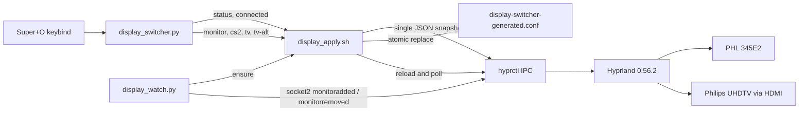

# Native HDMI Display Switcher Architecture

## Status

Implemented and live. The code under `src/` follows this document; the adapter-era runtime was deleted in the cutover.

The product scope is five exclusive modes across two display roles:

- `monitor`, `cs2`, `cs2-2k`: Philips 345E2 active; TV disabled. `cs2` and `cs2-2k` run the monitor at a custom ~75 Hz modeline with GPU Full-aspect pillarbox (patched Aquamarine required).
- `tv`, `tv-alt`: Philips 55OLED820 active over native HDMI 2.1; monitor disabled. `tv-alt` is `tv` with VRR off.

There is no Extend mode, Mirror mode, audio routing, or adapter recovery. The only automatic switch is the `ensure` failover, which acts solely when no known display is enabled and never changes an active one.

## Goals

1. Switch safely between the exclusive display modes from the existing GTK overlay.
2. Identify displays by EDID identity and connector class, not fixed DRM connector names.
3. Apply TV mode as 3840×2160 at 144 Hz, 10-bit, HDR, and VRR over native HDMI.
4. Verify the effective compositor state rather than assuming a successful `hyprctl` exit means the mode applied.
5. Fail before changing topology when required hardware or the exact target mode is unavailable.
6. Keep the implementation small enough to audit as a hardware control path.

## Non-goals

- Extend or Mirror modes.
- PipeWire, WirePlumber, ALSA, or default audio-sink management.
- CH7218/PCON DPCD writes, DP encoder resets, FRL adapter retries, GPU DPM pinning, or sudo access.
- Automatic fallback to 4K120, 4K60, 1080p144, 8-bit, SDR, or VRR-off operation.
- Migrating the entire HyDE configuration from hyprlang to Lua.
- General-purpose monitor profile management for unknown hardware.

## Grounded Current State

The target machine currently runs Hyprland 0.56.2. Live `hyprctl -j monitors all` discovery on the architecture date reported:

| Role | Current connector | EDID identity | Current active state |
|---|---|---|---|
| Monitor | `DP-2` | `Philips Consumer Electronics Company / PHL 345E2 / UK02226037640` | 3440×1440 @ 74.983 Hz, 8-bit |
| TV | `HDMI-A-1` | `Philips Consumer Electronics Company / Philips UHDTV / 0x01010101` | 3840×2160 @ 60 Hz, 8-bit, SDR, VRR off |

The TV's live mode list did not advertise 3840×2160@144 at that moment. This is an operational precondition, not a fallback decision: TV mode must fail closed until the TV input is set to **Optimal (Auto Game)** and Hyprland advertises a `3840x2160@144...` mode. The implementation must never silently select the advertised `1920x1080@144` mode or downgrade to 4K120.

## Profiles

### Monitor profile

| Field | Required value |
|---|---|
| Identity | Exact make/model/serial match for the PHL 345E2 |
| Mode | `3440x1440@74.98` |
| Position | `0x0` |
| Scale | `1` |
| Bit depth | `8` |
| Color preset | `srgb` |
| SDR EOTF | `srgb` |
| SDR saturation | `1.2` |
| VRR | `0` |
| Global HDR preference | off |

The TV is disabled in the final monitor profile.

### CS2 profiles

`cs2` and `cs2-2k` keep the monitor's color treatment (`bitdepth 8`, `cm srgb`, `sdr_eotf srgb`, `sdrsaturation 1.2`, VRR off) and swap only the mode for a custom modeline that the GPU pillarboxes at Full aspect. Both require a patched Aquamarine that accepts explicit modelines.

| Mode | Modeline | Purpose |
|---|---|---|
| `cs2` | custom `1920x1080@~75` | Competitive resolution with GPU Full-aspect pillarbox |
| `cs2-2k` | custom `2560x1440@~75` | Sharper CS2 resolution on the same path |

### TV profile

| Field | Required value |
|---|---|
| Identity | HDMI connector plus exact Philips UHDTV make/model match; ignore dummy serial `0x01010101` |
| Mode | `3840x2160@144` exactly; no fallback |
| Position | `0x0` |
| Scale | `1.5` |
| Bit depth | `10` |
| Color preset | `hdr` |
| SDR brightness | `3.0` |
| SDR saturation | `1.0` |
| SDR minimum luminance | `0` |
| SDR maximum luminance | `200` |
| Minimum luminance | `0` |
| Maximum luminance | `1400` |
| Maximum average luminance | `250` |
| Force HDR support | `1` |
| Force wide-color support | `1` |
| VRR | `1` (enabled continuously on this output) |
| Global HDR preference | on |

The desktop monitor is disabled in the final TV profile.

`tv-alt` is `tv` with VRR off (`vrr = 0`, `misc:vrr = 0`) and every other field identical.

The color and scale values above preserve the last intentional project tuning. Changing those values is a separate calibration decision, not part of the HDMI transport refactor.

SDR brightness is calibrated at `3.0` (Hyprland default `1.0`; `1.0 → 2.0 → 2.5 → 3.0` over the 2026-10-02 desktop-brightness tuning, with `5.0` tried and rejected as blown out): it lifts SDR white in HDR mode, which is this panel's only desktop-brightness lever (no backlight sysfs node, and the Philips UHDTV does not answer DDC/CI at `0x37`, so neither `brightnessctl` nor `ddcutil` can drive the panel) and, as a side effect, pushes VRR flicker on dark desktop content below the panel's visible gamma-wobble region. `3.0` puts SDR reference white at 600 cd/m² (`3.0 × sdr_max_luminance=200`); above that SDR highlights visibly clip, so treat `3.0` as the practical ceiling for this profile and change it in ≤`0.25` steps. Source audit of Hyprland 0.56.2: `CMonitorRuleParser::parseSDRBrightness` accepts any float — no range check, no clamp — and the only consumers are the color-management shader's `sdrBrightnessMultiplier` multiply and the SDR→HDR modifier gate, so this value alone cannot abort the compositor. The 2026-05-03 SIGABRT previously attributed to `2.0` was applied together with `cm = hdredid` plus explicit luminance overrides, both dropped later that evening; the current TV profile is `cm = hdr` with EDID-controlled luminance. `TV_ALT_PROFILE` must carry the same value so `tv` and `tv-alt` differ only in VRR.

## Component Boundaries



### `src/display_switcher.py`: presentation only

Terminal-style panel: monospace text, warm dark background, single cyan accent.

Responsibilities:

- Header with the active mode and a `$ display-apply.sh` prompt with a blinking cursor.
- One row per mode — `monitor`, `cs2`, `tv`, `tv-alt` — with device/spec columns and a `● active` or `not connected` tag. `cs2-2k` is applier-only and has no row.
- Ask the applier for `status` and `connected`; do not parse monitor topology independently.
- Dim unavailable rows and skip them during navigation.
- Keys: `Super+O`/`Down`/`j` next, `Up`/`k` previous, `1`–`4` apply that row directly, `Enter` apply, `Esc` cancel. The footer carries these hints and a 3 s auto-close countdown that resets on input.
- Launch the applier detached; on failure send a `notify-send` notification with the applier's last error line.
- Retain the existing single-instance/PID behavior.

The adapter-era eight-second cooldown is removed. Concurrency belongs to the applier lock; the overlay only prevents duplicate windows.

### `src/display_apply.sh`: sole control plane

Responsibilities:

- Own display discovery, state detection, preflight, config generation, application, workspace migration, verification, locking, and concise logging.
- Accept `status`, `connected`, `ensure`, and the five apply modes `monitor`, `cs2`, `cs2-2k`, `tv`, `tv-alt`.
- Read structured monitor data with `hyprctl -j monitors all` and `jq`; never scrape human-readable output.
- Emit only the status token on stdout for `status`, and only role names for `connected`. Diagnostics go to stderr and the log.
- Write a single hyprlang `monitorv2` generated file because the deployed HyDE configuration currently sources `display-switcher-generated.conf` after `monitors.conf`.
- Never call sudo or modify kernel, DRM debugfs, sysfs power levels, audio state, notification daemons, wallpaper daemons, or TV settings.

CLI contract:

| Invocation | stdout | Exit |
|---|---|---|
| `display_apply.sh status` | `monitor`, `cs2`, `cs2-2k`, `tv`, `tv-alt`, or `unknown` | 0 when discovery succeeded |
| `display_apply.sh connected` | connected roles, one per line in `monitor`, `tv` order | 0; empty stdout when none is connected |
| `display_apply.sh ensure` | concise success or no-op line | 0; no-op while any known display is enabled, else applies `monitor` if connected, else `tv` |
| `display_apply.sh monitor` | concise success line | 0 only after final verification |
| `display_apply.sh cs2` | concise success line | 0 only after final verification |
| `display_apply.sh cs2-2k` | concise success line | 0 only after final verification |
| `display_apply.sh tv` | concise success line | 0 only after final verification |
| `display_apply.sh tv-alt` | concise success line | 0 only after final verification |
| Invalid/missing command | usage | 2 |
| Discovery or preflight failure | diagnostic | 3; topology unchanged |
| Apply or verification failure | diagnostic | 4 |
| Another apply is running | diagnostic | 5 |

Mode → role: `monitor`, `cs2`, and `cs2-2k` require the `monitor` role; `tv` and `tv-alt` require the `tv` role.

### `src/display_watch.py`: failover watcher

Responsibilities:

- Run from Hyprland `exec-once` after the startup reload; also run once at startup so a saved mode whose display is gone recovers.
- Listen on Hyprland socket2 for `monitoradded` and `monitorremoved`, debounce 3 s, then run `display_apply.sh ensure`.
- Retry after 2 s when the applier lock is held (exit 5).
- Never switch away from a working display: `ensure` is a no-op while any known display is enabled.

### Generated configuration: persistent desired state

`~/.config/hypr/display-switcher-generated.conf` contains the complete desired state for both known displays and the mode-specific global HDR preference. It is generated through a temporary file in the same directory and an atomic rename. Partial files must never be visible to Hyprland.

Use the full EDID description in persistent rules so connector renumbering does not invalidate the next reload and the Monitor selector retains its serial. These are verbatim live Hyprland 0.56.2 `description` values, not strings assembled from separate JSON fields:

- `desc:Philips Consumer Electronics Company PHL 345E2 UK02226037640`
- `desc:Philips Consumer Electronics Company Philips UHDTV 0x01010101`

Hyprland selectors match either a connector name or a description prefix; they cannot conjunct EDID identity with `HDMI-A-*`. Runtime discovery therefore enforces the HDMI transport before every TV mutation, while the persistent rule uses the full EDID description for replug stability. The supported physical contract requires the TV to remain on native HDMI. Before intentionally changing its transport, apply Monitor mode so the persisted TV rule is disabled; a later TV request on a DP adapter must fail preflight.

Runtime IPC, workspace migration, and verification use connector names from the current JSON snapshot.

Hyprland 0.56 documents Lua as the preferred configuration format, but this machine still boots through a hyprlang/HyDE source chain. Supporting both formats caused avoidable branches and a second helper. The clean cutover supports the deployed hyprlang path only. A future whole-config Lua migration should replace it once, rather than retaining two generators indefinitely.

### `install.sh`: installation only

Responsibilities:

- Install/symlink `display_switcher.py`, `display_apply.sh`, and `display_watch.py`.
- Install the CSS and verify runtime dependencies: Bash, `hyprctl`, `jq`, Python 3, PyGObject, GTK3, and gtk-layer-shell.
- Verify that `hyprland.conf` sources `display-switcher-generated.conf` after `monitors.conf`; report an actionable error rather than editing unrelated user configuration silently.
- Remove repository-owned stale symlinks for `display-dpm.sh` and `fix-pcon-audio.py` during the clean cutover.

## Hardware Discovery Contract

One JSON snapshot is the source for a decision. Re-query only while polling after an apply.

1. Match the monitor by exact `make`, `model`, and `serial`.
2. Match the TV by connector name matching `^HDMI-A-`, exact `make`, and exact `model`. Do not use the dummy TV serial as identity.
3. Reject duplicate or ambiguous matches for either role and require matched roles to use different connectors.
4. Require exactly one match for the requested target. The non-target role may be absent; a disconnected TV must never block recovery into Monitor mode.
5. Before TV mode, require an advertised mode whose parsed resolution is 3840×2160 and refresh is within 0.1 Hz of 144.
6. Reject a missing, disconnected, or incapable target before writing a file or invoking reload.

Connector names are outputs of discovery, never configuration constants. `cs2` and `cs2-2k` need no advertised mode: they install a custom modeline through the patched Aquamarine, so preflight only requires the monitor role and HDMI preflight applies to the TV role alone.

## State Model

| Monitor role enabled | TV role enabled | Status |
|---|---|---|
| yes | no or absent | `monitor`, `cs2`, or `cs2-2k`, whichever monitor-side profile is active |
| no or absent | yes | `tv`, or `tv-alt` when the TV profile runs with VRR off |
| yes | yes | `unknown` |
| no or absent | no or absent | `unknown` |
| ambiguous role identity | any | discovery error |

`unknown` is a real state, not an alias for monitor mode. It lets the UI recover from manual changes without lying about the current topology.

## Safe Transition Transaction

The transaction preserves the invariant **at least one display remains active throughout**.

```mermaid
sequenceDiagram
    participant UI as Overlay
    participant A as Applier
    participant H as Hyprland
    participant F as Generated config

    UI->>A: apply mode
    A->>A: acquire lock
    A->>H: monitors all (JSON)
    A->>A: discover roles + validate exact target profile
    A->>F: snapshot previous file + live HDR preference
    A->>F: atomically write staging config (target active first; keep any active source)
    A->>H: reload
    A->>H: poll until target profile is active
    A->>H: migrate workspaces from any active source → target
    A->>F: atomically write final config (target active; non-target disabled by description)
    A->>H: reload
    A->>H: poll and verify complete final state
    A-->>UI: success only after verification
```

Rules:

1. Validate everything possible before mutation.
2. The staging config enables the target with its final profile while keeping any connected, active source at a non-overlapping `auto-right` position. If no source is connected, the verified target itself satisfies the invariant.
3. Replace arbitrary sleeps with bounded polling: poll structured state every 100 ms for up to five seconds, or fifteen when nothing was active before the switch (a target waking from a dark session can report 0×0 for several seconds).
4. Migrate active workspaces only after the target is verified active and before disabling a connected source.
5. The final config lists the active target rule before the disabled non-target rule.
6. On failure, restore the previous generated file atomically **without reloading it**, then restore the snapshotted live `quirks:prefer_hdr` value through IPC. This preserves the previous persistent and global HDR state while avoiding another risky monitor transition. Leave the live compositor with whichever one-or-two-display state still has an active output; exit nonzero with observed state. Rollback never restores a config with no active output.
7. Reapplying the current mode is idempotent and still performs final verification.

No retry reset loop is allowed. A second blind topology transition can hide the first failure and was needed only for the adapter.

## Verification Contract

### Monitor mode

Final JSON must show:

- Monitor enabled, TV disabled.
- Monitor width 3440, height 1440, refresh within 0.1 Hz of 74.98, scale 1.
- Monitor color preset is `srgb`; VRR is false. `currentFormat` is asserted only for 10-bit profiles, so the 8-bit profile adds no format check.
- `quirks:prefer_hdr` is false.

### cs2 / cs2-2k modes

Final JSON must show:

- Monitor enabled, TV disabled.
- Monitor at the custom 1920×1080 (`cs2`) or 2560×1440 (`cs2-2k`) mode, its ~75 Hz modeline refresh, scale 1.
- Monitor color preset is `srgb`; VRR is false; the 8-bit profile adds no `currentFormat` check.
- `quirks:prefer_hdr` is false.

### TV mode

Final JSON must show:

- TV enabled, monitor disabled.
- TV connector is still HDMI.
- TV width 3840, height 2160, refresh within 0.1 Hz of 144, scale 1.5.
- TV `currentFormat` is a 10-bit format.
- TV color preset is `hdr`.
- TV VRR is true.
- `quirks:prefer_hdr` is true.

For `tv-alt`, VRR must be false (`vrr` false, `misc:vrr` 0); every other field is as above.

The compositor state is the acceptance source. Log output, generated text, command exit status, and the TV on-screen information panel are supporting evidence, not substitutes.

## Failure Semantics

| Failure | Required behavior |
|---|---|
| Requested target disconnected or not uniquely identified | Exit 3; no mutation |
| 4K144 absent from advertised modes | Exit 3; no mutation and no fallback |
| `jq`/`hyprctl` unavailable or invalid JSON | Exit 3; no mutation |
| Staging target fails verification | Restore previous generated file and live HDR preference; leave source active; exit 4 |
| Final state fails verification | Restore previous generated file without monitor reload, restore live HDR preference through IPC, report all observed profile fields; exit 4 |
| Concurrent apply | Exit 5 immediately |
| `ensure` with no known display connected | Exit 3; nothing to enable |
| UI status returns `unknown` | Show neither mode as current; allow explicit recovery selection |

## Repository Cutover

### Retained

- `src/display_switcher.py`
- `src/display_apply.sh`
- `src/display_watch.py`
- `config/display-switcher.css`
- `install.sh`
- `monitors.conf`: comments plus `monitor = WAYLAND-1/2, disable` only. It deliberately holds no `monitorv2` blocks; the cold-boot fallback is HyDE's `monitor = ,preferred,auto,auto` in `base.conf`, and the generated file selects the real outputs.
- `research/`, as clearly labeled adapter history

### Deleted in the cutover

- `src/display-dpm.sh`
- `src/fix_pcon_audio.py`
- `src/debug-video.sh`
- `src/lua-monitor-lib.sh`
- `pw.dot`
- Ignored `src/__pycache__/`
- Stale generated Lua files and repository-owned deployed helper symlinks

Mirror/Extend branches, audio sink constants, PCON/DPCD functions, DPM functions, retry modes, fixed `DP-1`/`DP-2` role constants, six-second FRL sleeps, overlay cooldown, and daemon `pkill`/restart behavior are deleted rather than disabled.

## External Migration Boundary

These operations are required for the native-HDMI cutover but are not performed by project code:

1. Set the TV input to **HDMI Ultra HD → Optimal (Auto Game)** so the EDID advertises 4K144 and VRR.
2. Remove `amdgpu.dcdebugmask=0x420000`, `amdgpu.dcfeaturemask=0x0`, and `snd_hda_intel.probe_mask=1` from `/etc/default/limine`.
3. Run `sudo limine-update`, reboot, and verify the parameters are absent from `/proc/cmdline`.
4. Remove obsolete sudoers entries for `display-dpm.sh` and `fix-pcon-audio.py` using `visudo`.

The switcher must not attempt privileged bootloader or sudoers edits.

## Design Decisions

| Decision | Reason |
|---|---|
| Five modes over two display roles | Monitor-side CS2 modes use custom modelines and `tv-alt` is an explicit VRR-off TV choice; still no Mirror or Extend state |
| Exact TV mode, fail closed | A fallback could silently violate resolution, refresh, bit-depth, HDR, or VRR requirements |
| EDID identity plus runtime connector class | Full EDID selectors survive connector renumbering; runtime preflight rejects a TV not currently connected through native HDMI |
| One applier owns status and mutation | Prevents Python and Bash topology parsers from diverging |
| Structured JSON only | Human-readable `hyprctl` output already caused brittle detection |
| Staged then final reload | Preserves the no-zero-monitor invariant without mixing runtime legacy rules into `monitorv2` state |
| Hyprlang only for this cutover | Matches the deployed HyDE source chain; removes dual-format branching |
| No audio management | Outside the explicitly reduced display-only scope |
| No adapter fallback code | Native HDMI removes the hardware and its failure model |

## References

- [Hyprland monitor configuration](https://github.com/hyprwm/hyprland-wiki/blob/main/content/Configuring/Basics/Monitors.md): description selectors, disabling, bit depth, color management, luminance fields, and per-display VRR.
- [Hyprland variables](https://github.com/hyprwm/hyprland-wiki/blob/main/content/Configuring/Basics/Variables.md): VRR modes and `quirks.prefer_hdr`.
- Baseline checkpoint: `607ccaae0ad4c15ebf5592b72a8530f5ba504bac`.
- Adapter investigation remains under `research/` and is non-authoritative historical context for this design.
