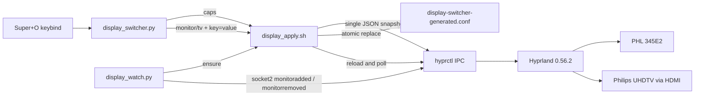

# Native HDMI Display Switcher Architecture

## Status

Implemented and live. The code under `src/` follows this document; the adapter-era runtime and the fixed-mode commands were removed in clean cutovers.

Two displays, each configured per apply:

- `monitor`: Philips PHL 345E2. Defaults `res=3440x1440 hz=74.98 vrr=0 hdr=0 scale=1`.
- `tv`: Philips 55OLED820 ("Philips UHDTV") over native HDMI 2.1. Defaults `res=3840x2160 hz=144 vrr=1 hdr=1 scale=1.5`.

An apply targets one display and sets resolution, refresh, VRR, HDR, and scale; omitted keys take that display's defaults. There is no Extend mode, Mirror mode, audio routing, or adapter recovery. The only automatic switch is the `ensure` failover, which applies a display's defaults solely when no known display is enabled.

## Goals

1. Configure and switch either display safely from the existing GTK overlay.
2. Identify displays by EDID identity and connector class, not fixed DRM connector names.
3. Reach TV settings up to 3840×2160 at 144 Hz, 10-bit, HDR, and VRR over native HDMI.
4. Verify the effective compositor state rather than assuming a successful `hyprctl` exit means the mode applied.
5. Fail before changing topology when the requested display or mode is unavailable.
6. Keep the implementation small enough to audit as a hardware control path.

## Non-goals

- Extend or Mirror modes.
- PipeWire, WirePlumber, ALSA, or default audio-sink management.
- CH7218/PCON DPCD writes, DP encoder resets, FRL adapter retries, GPU DPM pinning, or sudo access.
- Automatic fallback to 4K120, 4K60, 1080p144, 8-bit, SDR, or VRR-off operation.
- Migrating the entire HyDE configuration from hyprlang to Lua (the applier only keeps its own generated module valid for both managers).
- General-purpose monitor profile management for unknown hardware.

## Grounded Current State

The target machine currently runs Hyprland 0.56.2. Live `hyprctl -j monitors all` discovery on the architecture date reported:

| Role | Current connector | EDID identity | Current active state |
|---|---|---|---|
| Monitor | `DP-2` | `Philips Consumer Electronics Company / PHL 345E2 / UK02226037640` | 3440×1440 @ 74.983 Hz, 8-bit |
| TV | `HDMI-A-1` | `Philips Consumer Electronics Company / Philips UHDTV / 0x01010101` | 3840×2160 @ 60 Hz, 8-bit, SDR, VRR off |

The TV's live mode list did not advertise 3840×2160@144 at that moment. A disabled display omits its active mode from `availableModes`, so preflight accepts each display's own default resolution and refresh even when unadvertised, and `caps` merges that default into `modes`. Every non-default request must still be advertised (or be a custom monitor modeline); the applier never silently substitutes another mode or downgrades to 4K120.

Live-verified on 2026-11-18 against real hardware and the DRM readout: TV VRR on/off as a VRR-only change, HDR on/off, `3840x2160@120`, scale 1, and `2560x1440@120` at scale 1.6; monitor VRR on/off as a VRR-only change, scale 1.25 and 1.6, and the custom `1920x1080@74.65` / `2560x1440@74.89` modelines.

## Settings Model

Each display has one settings set: `res`, `hz`, `vrr`, `hdr`, `scale`. Position is always `0x0`, and the other display is disabled.

Scale candidates are `1`, `1.25`, `1.5`, `1.6`, `1.75`, `2`. Hyprland requires an integral logical size (`W/scale` and `H/scale` integers) and otherwise rounds the scale and shows an error overlay, so `caps` reports the scales valid at each resolution and the overlay offers only those.

| Display | Identity | Defaults |
|---|---|---|
| `monitor` | Exact make/model/serial match for the PHL 345E2 | `res=3440x1440 hz=74.98 vrr=0 hdr=0 scale=1` |
| `tv` | HDMI connector plus exact Philips UHDTV make/model match; ignore dummy serial `0x01010101` | `res=3840x2160 hz=144 vrr=1 hdr=1 scale=1.5` |

### Composition

`mode` comes from `res`+`hz`; `position` and `scale` come from the request. Color fields follow the display and its `hdr` value:

| Base | Fields |
|---|---|
| monitor, `hdr=0` | `bitdepth=8 cm=srgb sdr_eotf=srgb sdrsaturation=1.2` |
| tv, `hdr=1` | `bitdepth=10 cm=hdr sdrbrightness=3.0 sdrsaturation=1.0 sdr_min_luminance=0 sdr_max_luminance=200 min_luminance=0 max_luminance=1400 max_avg_luminance=250 supports_hdr=1 supports_wide_color=1` |
| tv, `hdr=0` | `bitdepth=10 cm=srgb sdr_eotf=srgb sdrsaturation=1.0` |

Globals: `misc:vrr = vrr`, `quirks:prefer_hdr = hdr`. `hdr=1` is refused for the monitor, which has no HDR composition.

### VRR is global only

Generated `monitorv2` blocks carry no `vrr`: the request's value is written once as `misc:vrr` and reasserted through IPC after each reload. Hyprland 0.56.2's `CMonitorRule::compare()` ignores `m_vrr`, so a VRR-only change compares as a full match, the per-monitor rule is not re-applied, and a stale per-monitor value would override `misc:vrr` in `ensureVRR()`. With exactly one display active, the global is the per-display VRR control.

Caveat: a session whose active rule still carries a per-monitor `vrr` from an older generated file keeps that value until the rule is re-applied — a display switch, a mode or scale change, or a Hyprland restart.

### Custom monitor modes

The monitor offers two modelines beyond its EDID list, both requiring the patched Aquamarine and GPU Full-aspect pillarbox. They are selected with `res=` + `hz=` and no extra key:

| Mode | Modeline |
|---|---|
| `1920x1080@74.65` | `modeline 220.75 1920 2056 2264 2608 1080 1083 1088 1130 -hsync +vsync` |
| `2560x1440@74.89` | `modeline 397.25 2560 2760 3040 3520 1440 1443 1448 1506 -hsync +vsync` |

The default color, scale, and SDR-brightness values preserve the last intentional project tuning. Changing them is a separate calibration decision, not part of the HDMI transport refactor.

SDR brightness is calibrated at `3.0` (Hyprland default `1.0`; `1.0 → 2.0 → 2.5 → 3.0` over the 2026-10-02 desktop-brightness tuning, with `5.0` tried and rejected as blown out): it lifts SDR white in HDR mode, which is this panel's only desktop-brightness lever (no backlight sysfs node, and the Philips UHDTV does not answer DDC/CI at `0x37`, so neither `brightnessctl` nor `ddcutil` can drive the panel) and, as a side effect, pushes VRR flicker on dark desktop content below the panel's visible gamma-wobble region. `3.0` puts SDR reference white at 600 cd/m² (`3.0 × sdr_max_luminance=200`); above that SDR highlights visibly clip, so treat `3.0` as the practical ceiling for this profile and change it in ≤`0.25` steps. Source audit of Hyprland 0.56.2: `CMonitorRuleParser::parseSDRBrightness` accepts any float — no range check, no clamp — and the only consumers are the color-management shader's `sdrBrightnessMultiplier` multiply and the SDR→HDR modifier gate, so this value alone cannot abort the compositor. The 2026-05-03 SIGABRT previously attributed to `2.0` was applied together with `cm = hdredid` plus explicit luminance overrides, both dropped later that evening; the current TV HDR base is `cm = hdr` with EDID-controlled luminance. `TV_HDR_COLOR` carries this value; the `tv` SDR base uses `cm = srgb` without it.

## Component Boundaries



### `src/display_switcher.py`: presentation only

Cold blue-black terminal panel (job-agent), Martian Mono (installed user-level in `~/.local/share/fonts/MartianMono`), tracked uppercase chrome, italic hints.

Responsibilities:

- Displays are the top level: one 1px frame per display (`MONITOR`, `TV`) whose legend carries role, device and transport, an inverse `ACTIVE` tag, and `SDR` when the display cannot do HDR; a disconnected frame reads `not connected`.
- Inside each frame: `RESOLUTION`, `REFRESH`, `VRR`, `HDR`, `SCALE` rows built from `caps`; VRR and HDR appear only when the display is capable, `SCALE` offers only the selected mode's valid scales, and a resolution change snaps the scale to the nearest valid one.
- Prompt shows the exact command, e.g. `$ display-apply.sh tv hz=120`, with a blinking cursor and only the keys that differ from the display's defaults.
- Initial values per display: remembered (if still valid against `caps`) → `current` → `defaults`, with remembered settings stored in `~/.local/state/display-switcher-settings.json`.
- Keys: `↑`/`↓` or `j`/`k` select, `←`/`→` or `h`/`l` change, `space` toggles, `Tab` or `Super+O` cycles displays, `1`/`2` apply that display, `Enter` applies the focused row's display, `Esc` closes. The footer shows the hints plus a 5 s auto-close countdown that resets on input.
- Launch the applier detached; on failure send a `notify-send` notification titled `<Display> failed` with the applier's last error line.
- Retain the existing single-instance/PID behavior.

The adapter-era eight-second cooldown is removed. Concurrency belongs to the applier lock; the overlay only prevents duplicate windows.

### `src/display_apply.sh`: sole control plane

Responsibilities:

- Own display discovery, state detection, preflight, config generation, application, workspace migration, verification, locking, and concise logging.
- Accept `status`, `caps`, `ensure`, and `monitor` / `tv` with optional `res=`, `hz=`, `vrr=`, `hdr=`, `scale=` keys.
- Read structured monitor data with `hyprctl -j monitors all` and `jq`; never scrape human-readable output.
- Emit only the status token for `status`, only the capabilities JSON for `caps`, and one success line for an apply. Diagnostics go to stderr and the log.
- Generate equivalent per-session display rules in hyprlang and Lua. Lua TV profiles also include a guard against being reapplied in a new compositor instance.
- Detect the running config manager once per mutating run and use `hyprctl keyword`/legacy `dispatch` under hyprlang, `hl.config`/`hl.dsp.*` under Lua (see Lua mode).
- Never call sudo or modify kernel, DRM debugfs, sysfs power levels, audio state, notification daemons, or wallpaper daemons. Only an explicit TV apply may request network wake.

CLI contract:

| Invocation | stdout | Exit |
|---|---|---|
| `display_apply.sh status` | `monitor`, `tv`, or `unknown` | 0; 3 on discovery failure |
| `display_apply.sh caps` | one JSON object describing both displays | 0; 3 on discovery failure or ambiguity |
| `display_apply.sh ensure` | concise success or no-op line | 0; prefers the monitor and only selects an already-awake TV |
| `display_apply.sh monitor [key=value ...]` | concise success line | 0 only after final verification |
| `display_apply.sh tv [key=value ...]` | concise success line | 0 only after final verification |
| Invalid/missing command | usage | 2 |
| Discovery or preflight failure | diagnostic | 3; topology unchanged |
| Apply or verification failure | diagnostic | 4 |
| Another apply is running | diagnostic | 5 |

Apply keys are `res=WxH`, `hz=N`, `vrr=0|1`, `hdr=0|1`, `scale=S`; omitted keys take the display's defaults, and unknown, duplicated, or malformed keys exit 2.

Preflight (exit 3, before any write or reload): the target is connected and uniquely identified; `res`+`hz` is an advertised mode within 0.1 Hz, a custom monitor modeline, or that display's own default; `vrr=1` requires `vrr_capable`; `hdr=1` requires `hdr_capable` and is refused for the monitor; `scale` is one of 1, 1.25, 1.5, 1.6, 1.75, 2 and must give an integral logical size at the requested resolution, otherwise exit 3 with `scale S gives a fractional logical size at WxH`.

The default resolution and refresh are accepted even when the display does not advertise them (a disabled TV drops 4K144 from `availableModes`), and `caps` merges that default into `modes`. The `vrr`/`hdr` capability gates apply only when the request differs from the display default, so optional probes never block defaults or failover.

The TV power gate runs before any generated config write. Explicit TV selection calls `tv_control.py wake`, rechecks HDMI discovery and settings, then requires the TV to accept `tv_control.py hdmi1`. Automatic failover requires `tv_control.py state` to report `on` and does not send wake or input commands. `caps` adds `power` (`on`, `standby`, `unknown`, or null if not a connected TV).

`caps` returns one object: `active` plus both displays in order, each with `device`, `connector`, `transport`, `connected`, `enabled`, `vrr_capable`, `hdr_capable`, `modes` (resolution plus rates, custom modelines merged, and the `scales` valid at that resolution), `defaults`, and `current`. A disconnected display reports null connector/transport and `current`, empty `modes`, and false capabilities; `hdr_capable` and `vrr_capable` come from read-only probes (`di-edid-decode`, `modetest`) and degrade to false when a tool is missing.

### `src/display_watch.py`: failover watcher

Responsibilities:

- Run from Hyprland `exec-once` after the startup reload; also run once at startup so saved settings whose display is gone recover.
- Listen on Hyprland socket2 for `monitoradded` and `monitorremoved`, debounce 3 s, then run `display_apply.sh ensure`.
- Retry after 2 s when the applier lock is held (exit 5).
- Poll while only the TV is active. With a monitor connected, `ensure` returns to it on standby or after three failed power checks spaced 2 s apart. Any `on` response cancels recovery; deep standby and sustained network failure are indistinguishable.

### Generated configuration: persistent desired state

`~/.config/hypr/display-switcher-generated.conf` contains the complete desired state for both displays and the request's global VRR/HDR preferences. Blocks carry mode, position, scale, and color fields, but no per-monitor `vrr` (see VRR is global only). `~/.config/hypr/display-switcher-generated.lua` carries the identical state for the Lua config manager: one `hl.config({ misc = { vrr = N }, quirks = { prefer_hdr = N } })`, then the same two `hl.monitor({ ... })` calls with the same fields and values (the non-target as `disabled = true`). One request builds both texts.

In Lua mode, a generated TV profile returns without applying rules when the current Hyprland instance signature differs from the one that generated it. The base monitor module must disable the TV before loading the profile; only a confirmed TV apply may override that base rule. Generated Lua rules set `disabled` explicitly on both outputs because `hl.monitor` merges rules with the same selector. Legacy hyprlang remains unguarded at config load.

Each file is generated through a temporary file in the same directory, validated (block/output counts, plus `luac5.5 -p` for the Lua module when available), and atomically renamed — hyprlang first, Lua last. Partial files must never be visible to Hyprland.

Use the full EDID description in persistent rules so connector renumbering does not invalidate the next reload and the Monitor selector retains its serial. These are verbatim live Hyprland 0.56.2 `description` values, not strings assembled from separate JSON fields:

- `desc:Philips Consumer Electronics Company PHL 345E2 UK02226037640`
- `desc:Philips Consumer Electronics Company Philips UHDTV 0x01010101`

Hyprland selectors match either a connector name or a description prefix; they cannot conjunct EDID identity with `HDMI-A-*`. Runtime discovery therefore enforces the HDMI transport before every TV mutation, while the persistent rule uses the full EDID description for replug stability. The supported physical contract requires the TV to remain on native HDMI. Before intentionally changing its transport, apply the monitor display so the persisted TV rule is disabled; a later `tv` request on a DP adapter must fail preflight.

Runtime IPC, workspace migration, and verification use connector names from the current JSON snapshot.

### Lua mode

Hyprland 0.56.2 supports two config managers, and this machine runs hyprlang while a Lua translation is staged (`hyprland.staged.lua`, loaded later as `hyprland.lua`). Rollback to hyprlang must keep working until the hyprlang files are deleted, so the applier supports both and is manager-agnostic about its persisted state: both generated files are written on every apply from one request, so the current session and a future Lua session read the same desired state. `require("display-switcher-generated")` in the Lua tree picks up the module; the hyprlang chain keeps sourcing the `.conf`.

Detection runs once per mutating command, after the lock and before any mutation, with a side-effect-free `hyprctl eval 'return 1'`:

| Reply | Manager |
|---|---|
| `ok` | `lua` |
| contains `only supported with the lua config manager` | `hyprlang` |
| anything else (no instance, socket error, `error: …`) | exit 3, no mutation |

`status` and `caps` mutate nothing and skip detection.

Manager-specific calls (hyprlang unchanged):

| Operation | Lua mode |
|---|---|
| `hyprctl keyword misc:vrr N` / `quirks:prefer_hdr N` | one `hyprctl eval 'hl.config({ misc = { vrr = N }, quirks = { prefer_hdr = N } })'`; a reply starting with `error` fails the apply (`keyword` is refused with exit 0 under Lua and would silently do nothing) |
| `hyprctl reload` | same command; synchronous in both managers |
| `hyprctl configerrors` | required after every Lua reload: `reload` replies `ok` even when the Lua config raised errors, so errors mentioning the generated module fail the apply |
| `hyprctl dispatch dpms on CONN` | `hyprctl dispatch 'hl.dsp.dpms({ action = "enable", monitor = "CONN" })'`; only a connector from the current snapshot is passed, because Hyprland #16471 makes a non-matching selector act on all monitors. `enable`/`on` and `disable`/`off` are recognised and any other string silently means `toggle`, so the action is spelled `enable` |
| `hyprctl dispatch moveworkspacetomonitor ID CONN` | `hyprctl dispatch 'hl.dsp.workspace.move({ workspace = "ID", monitor = "CONN" })'` (old syntax is a Lua syntax error) |

The explicit synchronous reload stays in Lua mode instead of relying on the config watcher: the module rename can trigger one extra asynchronous reload of the same file, which is harmless, and verification polls compositor state rather than timing. Rollback restores both files (or removes both when neither existed) and reasserts the snapshotted globals through the manager-appropriate call.

When the hyprlang configuration is deleted, delete the hyprlang generation path and the `keyword` branch together; the Lua module is then the only generated file.

### `install.sh`: installation only

Responsibilities:

- Install/symlink `display_switcher.py`, `display_apply.sh`, and `display_watch.py`.
- Install the CSS and verify runtime dependencies: Bash, `hyprctl`, `jq`, Python 3, PyGObject, GTK3, and gtk-layer-shell.
- Verify that `hyprland.conf` sources `display-switcher-generated.conf` after `monitors.conf`; report an actionable error rather than editing unrelated user configuration silently.
- Remove repository-owned stale symlinks for `display-dpm.sh` and `fix-pcon-audio.py` during the clean cutover.

## Hardware Discovery Contract

One JSON snapshot is the source for a decision. Re-query only while polling after an apply.

1. Match the monitor by exact `make`, `model`, and `serial`.
2. Match the TV by connector name matching `^HDMI-A-`, exact `make`, and exact `model`. Do not use the dummy TV serial as identity.
3. Reject duplicate or ambiguous matches for either role and require matched roles to use different connectors.
4. Require exactly one match for the requested target. The non-target role may be absent; a disconnected TV must never block recovery into the monitor display.
5. Accept `res`+`hz` when it is an advertised mode within 0.1 Hz, a custom monitor modeline, or the target display's own default resolution and refresh.
6. Reject a missing, disconnected, or incapable target — including unsupported VRR/HDR that differs from the display default, an unsupported scale, or a scale that makes the logical size fractional at the requested resolution — before writing a file or invoking reload.

Connector names are outputs of discovery, never configuration constants. Custom monitor modelines install through the patched Aquamarine, so they never depend on the EDID mode list.

## State Model

| Monitor role enabled | TV role enabled | Status |
|---|---|---|
| yes | no or absent | `monitor` |
| no or absent | yes | `tv` |
| yes | yes | `unknown` |
| no or absent | no or absent | `unknown` |
| ambiguous role identity | any | discovery error |

`unknown` is a real state, not an alias for the monitor display. It lets the UI recover from manual changes without lying about the current topology.

## Safe Transition Transaction

The transaction preserves the invariant **at least one display remains active throughout**.

```mermaid
sequenceDiagram
    participant UI as Overlay
    participant A as Applier
    participant H as Hyprland
    participant F as Generated config

    UI->>A: apply request
    A->>A: acquire lock
    A->>H: monitors all (JSON)
    A->>A: discover roles + validate request
    A->>F: snapshot previous file + live HDR preference
    A->>F: atomically write staging config (target active first; keep any active source)
    A->>H: reload
    A->>H: poll until the requested settings are active
    A->>H: migrate workspaces from any active source → target
    A->>F: atomically write final config (target active; non-target disabled by description)
    A->>H: reload
    A->>H: poll and verify complete final state
    A-->>UI: success only after verification
```

Rules:

1. Validate everything possible before mutation.
2. The staging config enables the target with its resolved settings while keeping any connected, active source at a non-overlapping `auto-right` position. If no source is connected, the verified target itself satisfies the invariant.
3. Replace arbitrary sleeps with bounded polling: poll structured state every 100 ms for up to five seconds, or fifteen when nothing was active before the switch (a target waking from a dark session can report 0×0 for several seconds).
4. Migrate active workspaces only after the target is verified active and before disabling a connected source.
5. The final config lists the active target rule before the disabled non-target rule.
6. On failure, restore both previous generated files atomically (a file that did not exist before is removed), reload them, then restore the snapshotted live `misc:vrr` and `quirks:prefer_hdr` values through IPC. This preserves the previous persistent and global VRR/HDR state. Leave the live compositor with whichever one-or-two-display state still has an active output; exit nonzero with observed state. Rollback never restores a config with no active output.
7. Reapplying the same settings is idempotent and still performs final verification.

No retry reset loop is allowed. A second blind topology transition can hide the first failure and was needed only for the adapter.

## Verification Contract

### Per apply

Final JSON must show:

- The requested display enabled and the other display disabled, with the TV still on an `HDMI-A-*` connector.
- The requested width and height, with refresh within 0.1 Hz of the request (custom monitor modelines included).
- The requested scale, `vrr`, and the color preset of the composed base (`srgb` for SDR, `hdr` for TV HDR).
- A 10-bit `currentFormat` when the composed base is 10-bit (the TV in both HDR and SDR).
- Globals `misc:vrr` equal to the requested `vrr` and `quirks:prefer_hdr` equal to the requested `hdr`.

The compositor state is the acceptance source. Log output, generated text, command exit status, and the TV on-screen information panel are supporting evidence, not substitutes.

### DRM ground truth

The final poll also reads the kernel's DRM state through read-only `modetest -c/-e/-p`:

- CRTC mode width/height and refresh within 0.1 Hz of the request, including user-defined modelines named like `1920x1080@74`.
- `VRR_ENABLED` equal to the requested `vrr`.
- Connector `Colorspace` = 9 (`BT2020_RGB`) for `hdr=1`, 0 (`Default`) for `hdr=0`.
- `HDR_OUTPUT_METADATA` EOTF 0x02 for `hdr=1`; empty or 0 for `hdr=0`.

A missing or unparseable `modetest` skips the DRM check with a single log line and never blocks an apply. On failure the observed-state report adds a `DRM` line, or `DRM unavailable: <reason>`.

## Failure Semantics

| Failure | Required behavior |
|---|---|
| Requested target disconnected or not uniquely identified | Exit 3; no mutation |
| Requested `res`+`hz` not advertised, not a custom modeline, and not the display default | Exit 3; no mutation and no substitution |
| Requested `vrr=1`/`hdr=1` when the display is not capable and the request differs from its default | Exit 3; no mutation |
| `jq`/`hyprctl` unavailable or invalid JSON | Exit 3; no mutation |
| Staging target fails verification | Restore previous generated files and live VRR/HDR preferences; leave source active; exit 4 |
| Final state fails verification | Restore previous generated files, restore live VRR/HDR preferences through IPC, report all observed fields plus the DRM line; exit 4 |
| Lua-mode reload reports config errors naming the generated module | Treat as a failed reload: restore previous files and globals; exit 4 |
| Concurrent apply | Exit 5 immediately |
| `ensure` with no known display connected | Exit 3; nothing to enable |
| `status` reports `unknown` | Header shows no active display; defaults remain selectable |

## Repository Cutover

### Retained

- `src/display_switcher.py`
- `src/display_apply.sh`
- `src/display_watch.py`
- `config/display-switcher.css`
- `install.sh`
- `monitors.conf`: comments plus `monitor = WAYLAND-1/2, disable` only. It deliberately holds no `monitorv2` blocks; the cold-boot fallback is HyDE's `monitor = ,preferred,auto,auto` in `base.conf`, and the generated file selects the real outputs.
- `research/`, as clearly labeled adapter history

### Deleted in the cutover

- `src/display-dpm.sh`
- `src/fix_pcon_audio.py`
- `src/debug-video.sh`
- `src/lua-monitor-lib.sh`
- `pw.dot`
- Ignored `src/__pycache__/`
- Stale adapter-era generated Lua files and repository-owned deployed helper symlinks (the current `display-switcher-generated.lua` is generated at runtime, not repository-owned)

Mirror/Extend branches, audio sink constants, PCON/DPCD functions, DPM functions, retry modes, fixed `DP-1`/`DP-2` role constants, six-second FRL sleeps, overlay cooldown, and daemon `pkill`/restart behavior are deleted rather than disabled.

## External Migration Boundary

These operations are required for the native-HDMI cutover but are not performed by project code:

1. Set the TV input to **HDMI Ultra HD → Optimal (Auto Game)** so the EDID advertises 4K144 and VRR.
2. Remove `amdgpu.dcdebugmask=0x420000`, `amdgpu.dcfeaturemask=0x0`, and `snd_hda_intel.probe_mask=1` from `/etc/default/limine`.
3. Run `sudo limine-update`, reboot, and verify the parameters are absent from `/proc/cmdline`.
4. Remove obsolete sudoers entries for `display-dpm.sh` and `fix-pcon-audio.py` using `visudo`.

The switcher must not attempt privileged bootloader or sudoers edits.

## Design Decisions

| Decision | Reason |
|---|---|
| Two displays with per-apply settings, not fixed modes | One code path builds mode, color, VRR, and globals from the request; fixed mode names and aliases were removed |
| Fail closed on unavailable requests | A silent substitution would violate the requested resolution, refresh, bit-depth, HDR, or VRR |
| EDID identity plus runtime connector class | Full EDID selectors survive connector renumbering; runtime preflight rejects a TV not currently connected through native HDMI |
| One applier owns status and mutation | Prevents Python and Bash topology parsers from diverging |
| Structured JSON only | Human-readable `hyprctl` output already caused brittle detection |
| Staged then final reload | Preserves the no-zero-monitor invariant without mixing runtime legacy rules into `monitorv2` state |
| Dual generated output while both managers are possible | Rollback to hyprlang must keep working until the hyprlang config is deleted; one resolved request writes both files so the managers cannot diverge |
| Explicit synchronous `hyprctl reload` in Lua mode | Verification polls compositor state; a possible extra watcher reload re-reads the same file and cannot change the outcome |
| `configerrors` check after Lua reloads | `reload` replies `ok` even for a broken Lua config; only errors naming the generated module fail the apply |
| No audio management | Outside the explicitly reduced display-only scope |
| No adapter fallback code | Native HDMI removes the hardware and its failure model |

## Known Limitations

- A display whose active `monitorv2` rule still carries a per-monitor `vrr` from an older generated file keeps that value until the rule is re-applied: a display switch, a mode or scale change, or a Hyprland restart. Current generated files carry no per-monitor `vrr`.
- DRM verification is skipped when `modetest` is missing or its output is unparseable; the Hyprland-level checks still apply.

## References

- [Hyprland monitor configuration](https://github.com/hyprwm/hyprland-wiki/blob/main/content/Configuring/Basics/Monitors.md): description selectors, disabling, bit depth, color management, luminance fields, and per-display VRR.
- [Hyprland variables](https://github.com/hyprwm/hyprland-wiki/blob/main/content/Configuring/Basics/Variables.md): VRR modes and `quirks.prefer_hdr`.
- Baseline checkpoint: `607ccaae0ad4c15ebf5592b72a8530f5ba504bac`.
- Adapter investigation remains under `research/` and is non-authoritative historical context for this design.
